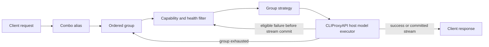

# CPA Model Combo Engine v2 — execution plan

## Context

### Executive summary

Build a new native plugin identity, `model-combo`, from the current `model-router` fork. Keep CLIProxyAPI as provider/auth/protocol/account executor. Add ordered combo groups above physical model selection:



MVP is genuine multi-group routing with independent `priority`, `round-robin`, and smooth `weighted-round-robin` group selection; bounded attempts; conservative failure classes; cooldown/circuit state; request capability gates; response alias rewriting; reload-safe state; and pre-commit-only stream fallback. Adaptive routing and session affinity follow after measured, attributable health data exists. No provider authentication, OAuth, credential storage, account selection, direct provider transport, or protocol stack is copied from OmniRoute.

Use distinct ID/name/artifacts/routes so original `model-router` and `model-combo` can both be installed. Operators must not enable overlapping aliases in both plugins because host router priority would make ownership order-dependent. Existing `routes` and `model-routes` config remains accepted by `model-combo` and normalizes to one-group combos; this is migration, not an automatic cross-plugin config read.

### Verified findings

Current checkout is authoritative:

- Module `github.com/markhuangai/cpa-plugin-model-router`, Go `1.26.0`, CLIProxyAPI `v7.3.9`, SQLite `go-sqlite3 v1.14.50`.
- Current identity: `pluginID = "model-router"`, `pluginName = "Model Router"`; native artifact `model-router.{so,dylib,dll}`.
- `main.go` and `Makefile` default to `pluginVersion = "0.4.2"`, while checkout tag is `v0.5.5`. Release builds inject tag-derived version through `-X main.pluginVersion=$VERSION`; local builds without `VERSION` expose stale `0.4.2`.
- Export/registration contract uses `cliproxy_plugin_init`, `ModelRouterPluginCall`, `ModelRouterPluginFree`, `ModelRouterPluginShutdown`, registration schema 2, and stream-body omission schema 3. Only `cliproxy_plugin_init` is host entry ABI; callback/free/shutdown function addresses are returned in the registration struct.
- Implemented capabilities: `pluginapi.ModelRouter`, `ModelRegistrar`, `ProviderExecutor`, `RequestInterceptor`, and `UsagePlugin`.
- Current config strictly decodes one YAML document with `KnownFields(true)`. It supports `routes` or `model-routes`, never both. A route has alias, strategy (`priority` or `round-robin`), cooldown, and weighted targets; `models` is legacy input for `targets`.
- Current defaults: cooldown 60 seconds, target weight 1, max weight 1,000,000; fallback status list 401/402/403/404/408/429/500/502/503/504. Unlisted 5xx still fallback unless explicitly excluded.
- Current request attempt set prevents retrying one physical model twice in one request. Current group-equivalent selection is one flat route. If all targets cool, execution returns immediately rather than advancing to another group.
- Current stream retries only before an upstream payload is received. `forwardStreamAttempt` rewrites model fields and closes host streams. It never splices successful payloads from multiple targets.
- Current ABI enters with `context.Background()`. `executeWithHost` has no context argument, `startStream` starts a goroutine with `context.Background()`, and host callback methods are synchronous. Pinned `v7.3.9` exposes no host-model cancel callback.
- Pinned `HostModelExecutionRequest` contains entry/exit protocol, model, stream, raw body, headers, query, alt, optional forced provider, and optional auth ID. Response contains status, headers, body or stream ID. It does not report host-selected provider/auth identity.
- `ExecutorRequest` received by the plugin does contain plugin executor auth fields, original request, translated payload, source/target format, metadata, and headers. Those auth fields do not identify the downstream account later selected by the nested host execution.
- `UsageRecord` later reports provider, model, alias, session ID, auth ID/index/type, reasoning effort, timing, tokens, and failure. Existing storage deliberately omits raw auth/session values and correlates routed attempts with bounded in-memory HMAC/fingerprint markers. Ambiguous records remain unattributed.
- `ModelInfo` can describe context limits, supported parameters, generation methods, and modalities, but pinned host model-execution callback does not expose the resolved target model metadata/catalog to this plugin.
- Request body handling prefers `OriginalRequest`, preserves raw request and tool arguments, changes only top-level `model`, and asks CPA host execution to handle protocol/provider work. Responses rewrite known model fields to requested alias. SSE rewrite buffering is capped at 1 MiB.
- Runtime state is mutex-protected. `Clone` preserves cursor/cooldown only when route signature is unchanged. Reconfigure reuses usage store, attribution tracker, models.dev fetcher, and price-sync state.
- SQLite uses WAL, busy timeout 5000 ms, schema version 1, `store_state`, append-style `requests`, and `minute_aggregates`; it includes retention pruning and robust legacy bbolt migration/recovery. Do not replace it.
- Existing management routes are host-registered under `/plugins/model-router/...`; browser URLs are `/v0/management/plugins/model-router/...`. Host owns management authentication. Config load/save uses host-provided `/v0/management/plugins/model-router/config`; plugin registers only validation and usage routes. Embedded dashboard uses the management key only for authenticated host requests.
- Existing dashboard is embedded from `dashboard.html` and `dashboard/**`, with Configuration and Usage tabs. It edits flat routes and fetches `/v1/models` in-browser.
- Existing integration tests build/run disposable CLIProxyAPI and mock upstreams. CI runs formatting, unit, race, vet, minimum CPA v7.3.9 integration, native build, and Windows SQLite checks.
- Release helper already builds linux/amd64, linux/arm64, darwin/amd64, darwin/arm64, and windows/amd64 with CGO and tag-injected version.
- Official store registry schema is 1. IDs are unique and restricted to ASCII letters/digits plus `._-`, max 128. Release tag is `v<version>`; assets are `<id>_<version>_<goos>_<goarch>.zip`, contain root `<id>.so|dylib|dll`, plus sha256sum-format `checksums.txt`. Current registry has no `model-router` or `model-combo` entry; recheck immediately before store PR.
- Official docs confirm native plugins are trusted in-process code and management routes/resources are host-authenticated. Host callbacks are preferred so CPA retains proxy, logging, credentials, execution, and translation.
- OmniRoute `release/v3.8.52` has a much broader combo engine: many strategies, retry/delay/timeout controls, stickiness, quota/account logic, capability checks, adaptive scoring, parallelism, and provider infrastructure. Only ordered pool/group, fallback, weighting, health, and measurement concepts apply here. Provider connections, OAuth/session/account occupancy, direct transport, and speculative strategy set do not.

Primary external evidence:

- Pinned SDK types: https://github.com/router-for-me/CLIProxyAPI/blob/v7.3.9/sdk/pluginapi/types.go
- Official plugin development: https://help.router-for.me/plugin/development
- Official host callbacks: https://help.router-for.me/plugin/host-callbacks
- Official model router capability: https://help.router-for.me/plugin/model-router
- Official management capability: https://help.router-for.me/plugin/management-api
- Official plugin store format: https://github.com/router-for-me/CLIProxyAPI-Plugins-Store/blob/main/README.md
- Original router repository: https://github.com/markhuangai/cpa-plugin-model-router
- OmniRoute combo schema/service reference (`release/v3.8.52`): https://github.com/diegosouzapw/OmniRoute/blob/release/v3.8.52/src/shared/validation/schemas/combo.ts and https://github.com/diegosouzapw/OmniRoute/blob/release/v3.8.52/open-sse/services/combo.ts

### Gaps to close

| Area | Current behavior | Required v2 behavior |
|---|---|---|
| Hierarchy | alias → flat route → model | alias → combo → ordered group → candidate → CPA host |
| Selection | route-level priority or weighted RR | independent priority, RR, or smooth weighted RR per group |
| Exhaustion | one pool; all-cooling can terminate early | exhaust eligible candidates in group, then advance group |
| Budget | at most target count, no global limit/deadline/backoff | total attempt cap, elapsed deadline checks, bounded Retry-After/exponential backoff |
| Health | one failure starts cooldown | failure-class-aware cooldown plus closed/open/half-open circuit |
| Failure semantics | status lists plus transport heuristics | explicit terminal/transient/quota/context/capability/cancel taxonomy |
| Capabilities | none | request requirements + explicit target declarations; unknown never fabricated |
| Reasoning | body preserved and delegated | preserve exactly; filter known incompatibility; no silent effort downgrade |
| Affinity | none | optional bounded HMAC-keyed target stickiness after MVP |
| Stream | payload-received retry boundary | client-visible commit boundary, tested for pre/during/post payload cases |
| Attribution | best-effort route alias/model | combo/group/candidate/attempt markers; ambiguity remains explicit |
| Persistence | usage/prices/preferences only | schema migration for aggregate health and circuit snapshots; privacy-safe |
| UI | flat routes | nested combo/group/candidate editor plus health/attempt diagnostics |
| Identity | collides with original plugin | separate `model-combo` ID, binary, routes, storage default, release assets |
| Browser testing | HTML assembly + HTTP integration | real Chromium interaction against disposable CPA |

## Approach

### 1. Freeze contracts, identity, and config normalization — P0, medium

**Identity and packaging**

- Change stable identity to `pluginID = "model-combo"`, `pluginName = "Model Combo"`, repository URL for this repository, artifact base `model-combo`, management paths `/plugins/model-combo/...`, browser paths `/v0/management/plugins/model-combo/...`, resource `/v0/resource/plugins/model-combo/config`, and distinct default data path `model-combo/usage.db` using current platform path resolution convention.
- Rename internal exported callback symbols to `ModelComboPluginCall`, `ModelComboPluginFree`, and `ModelComboPluginShutdown`; retain exact host-required `cliproxy_plugin_init` and current registration schemas/capabilities.
- Use `0.0.0-dev` for un-injected local metadata. Release `v0.1.0` is first new-identity release; workflow remains tag-driven and injects `0.1.0`. Add a release test that builds with an injected version and checks registration metadata and archive names. Never derive runtime version by invoking Git.
- Update release/test workflows, Makefile, shell helpers, README install commands, dashboard constants, integration expected filenames, and future store entry together. Before store PR, fetch current `registry.json` and reject ID collision.

**Canonical schema**

```yaml
plugins:
  configs:
    model-combo:
      enabled: true
      priority: 0
      data_path: ./data/model-combo-usage.db
      retention_days: 365

      resilience:
        max_attempts: 4              # 1..16; total across all groups
        deadline_ms: 120000          # elapsed budget checked before selection/backoff/callback
        base_backoff_ms: 100
        max_backoff_ms: 2000
        honor_retry_after: true
        circuit_failure_threshold: 3
        circuit_open_seconds: 60
        circuit_max_open_seconds: 900

      fallback:
        fallback_on_status: [401, 402, 403, 404, 408, 429, 500, 502, 503, 504]
        no_fallback_on_status: []
        stream_fallback_before_first_chunk_only: true

      combos:
        - alias: high-reasoning
          groups:
            - name: premium
              strategy: priority
              cooldown_seconds: 60
              targets:
                - model: provider-a/reasoning-large
                  capabilities: [reasoning, tools]
                - model: provider-b/reasoning-large
                  capabilities: [reasoning, tools]
            - name: standard
              strategy: weighted-round-robin
              targets:
                - model: provider-c/reasoning-medium
                  weight: 2
                  capabilities: [reasoning, tools]
                - model: provider-d/reasoning-medium
                  weight: 1
                  capabilities: [reasoning]

        - alias: medium-reasoning
          groups:
            - name: balanced
              strategy: round-robin
              targets:
                - model: provider-a/reasoning-medium
                  capabilities: [reasoning]
                - model: provider-b/reasoning-medium
                  capabilities: [reasoning]

        - alias: complex-coding
          groups:
            - name: coding-primary
              strategy: weighted-round-robin
              targets:
                - model: provider-a/coding-large
                  weight: 3
                  capabilities: [reasoning, tools]
                - model: provider-b/coding-large
                  weight: 1
                  capabilities: [reasoning, tools]
            - name: coding-fallback
              strategy: priority
              targets:
                - model: provider-c/coding-medium
                  capabilities: [tools]

        - alias: common-task
          groups:
            - name: general
              strategy: round-robin
              targets:
                - model: provider-a/general-medium
                - model: provider-b/general-medium

        - alias: small-task
          groups:
            - name: fast
              strategy: weighted-round-robin
              targets:
                - model: provider-a/general-small
                  weight: 4
                - model: provider-b/general-small
                  weight: 1
```

Example model IDs are deliberately illustrative; operators replace them with exact IDs returned by their CPA `/v1/models`. Capability declarations are operator assertions, not inferred facts.

Schema rules:

- Top-level current keys `enabled`, `priority`, `store`, `data_path`, `retention_days`, `fallback`, `routes`, and `model-routes` remain valid. New keys: `combos`, `resilience`.
- `routes` and `model-routes` remain mutually exclusive. Either may coexist with `combos` only when aliases are unique across normalized output.
- Normalize every old route to one combo with one group named `default`, preserving route strategy, cooldown, target order, `models`, `targets`, target weights, thinking suffix behavior, and fallback policy. `round-robin` plus non-unit weights keeps current weighted behavior semantically; normalized runtime uses smooth weighted RR.
- Existing legacy routes retain effective attempt budget equal to their target count, capped by existing validated route size, so upgrade does not silently reduce failover. New combos use `resilience.max_attempts` default 4.
- Combo aliases are case-insensitively unique after trim, must not equal any physical target under the same normalized config, and may not be targets. This bans direct/indirect recursion rather than trying to resolve nested combos.
- Group names are required, trimmed, case-insensitively unique within combo. Group order is semantic. Each group requires exactly one of `targets` or legacy shorthand `models`; never both.
- Strategies accepted now: `priority`, `round-robin`, `weighted-round-robin`. Reject adaptive/unknown names until implemented. `priority` rejects non-default weights because ignored weights are ambiguous. `round-robin` requires all weights 1. `weighted-round-robin` requires positive weights.
- Candidate models are unique within a combo after thinking-suffix normalization. This ensures one physical target is attempted at most once per request even if accidentally repeated across groups.
- Capabilities are an enum: `reasoning`, `tools`, `vision-input`, `audio-input`, `document-input`, `json-schema`. Reject unknown values. Omitted means unknown, not unsupported.
- Limits for deterministic validation and Pi bounds: 128 combos/plugin, 16 groups/combo, 32 targets/group, 256 targets/combo, 16 total attempts/request, alias/group/model length 300, unique names after trim/fold. Keep current 1 MiB management body cap.
- `stream_fallback_before_first_chunk_only: false` remains rejected. It documents an invariant, not an unsafe switch.
- `deadline_ms` is an orchestration budget, not a promise to interrupt a blocked `host.model.execute`; validation/help text must say so.

**Definition of Done**

- Old README canonical `routes` and fork-style `model-routes` decode to identical one-group internal combos and produce same target sequence in compatibility tests.
- Mixed valid `combos` + `routes` works. Alias collision, duplicate group/candidate, both target forms, recursion, unknown key/strategy/capability, invalid bounds, and second YAML document fail with stable field-specific errors.
- Registration, management, config, binary, archive, and store IDs all say `model-combo`; no `model-router` route/artifact collision remains.

### 2. Build immutable combo plan and independent selectors — P0, large

Introduce compiled immutable config separate from mutable runtime:

- `comboPlan`: alias, ordered `groupPlan`s, resolved resilience/fallback values, normalized signature.
- `groupPlan`: stable name/index, strategy, cooldown, immutable candidate slice.
- `candidatePlan`: model, weight, declared capability set, stable candidate key.
- `comboRuntime`: mutex-sharded state keyed by combo/group signature. Per-group cursor/current smooth weights; per-candidate cooldown, circuit state, consecutive failures, open count, half-open probe flag, and aggregate counters.
- One request-local `attemptLedger` tracks candidate keys, attempt count, elapsed budget, last meaningful error, and stream commitment. It is never shared.

Selection algorithm:

1. Match requested alias after existing thinking-suffix split.
2. Extract request capability requirements without changing request data.
3. Visit groups in YAML order.
4. Remove request-attempted candidates, known capability conflicts, active cooldowns, open circuits, and occupied half-open probes.
5. If affinity is enabled in later phase and its candidate remains eligible, prefer it.
6. Select using only that group's strategy.
7. Execute target through CPA host callback; CPA still chooses provider/account/auth.
8. On success, close health circuit/reset consecutive failures, record selection, and return.
9. On eligible candidate failure, classify, update health, wait bounded backoff if budget permits, and select another candidate in same group.
10. When group has no eligible unattempted candidate, advance. If all groups fail, return one structured error containing safe class/status/group/candidate summaries, never raw prompt, headers, auth, session key, or full upstream body.

Strategy details:

- `priority`: first eligible target in declared order.
- `round-robin`: atomic/mutex cursor advances after selection; skipped candidates do not consume permanent extra turns.
- `weighted-round-robin`: smooth weighted RR (`current += weight`, choose max, subtract total), deterministic tie by YAML order. Recompute only across configured group while skipping unavailable candidates for this pick. Use checked `int64`; validation limits prevent overflow.
- Selector state is independent per combo/group. A failure in one combo does not move another combo's cursor.
- Candidate health key is combo alias + group name + normalized physical model. Do not globally poison the same model in unrelated policy contexts.

Reload:

- Parse/validate/compile before acquiring live state.
- Build replacement plugin instance; preserve runtime state only for exact combo/group/candidate signatures. Copy under old runtime lock, publish new instance atomically through existing ABI state, then reconfigure store under current price-sync/store lock order.
- Removed state becomes unreachable and is pruned from persistence. Changed weight/strategy resets selector state but may retain candidate aggregate measurements by stable health key only when candidate identity and policy remain compatible.
- Never hold runtime lock across host execution, stream read, SQLite I/O, sleep, or callback.

**Definition of Done**

- Deterministic table/property tests prove group order, selector independence, smooth weight ratios over a full weight cycle, no duplicate candidate attempt, next-group exhaustion, all-cooling behavior, and overflow bounds.
- `go test -race` stress test concurrently selects, marks health, snapshots, and repeatedly reloads changed/unchanged config without races or deadlocks.
- Throwaway smoke invokes real plugin path against mock host: first group exhausts, second succeeds, response alias is restored.

### 3. Add conservative resilience and failure taxonomy — P0, large

Use typed `attemptFailure` instead of repeatedly parsing strings. Classification precedence:

1. **cancelled**: local/request context cancellation; terminal, no cooldown/circuit penalty.
2. **deadline-exhausted**: orchestration budget exhausted; terminal, no new attempt.
3. **context-overflow**: only explicit structured error codes/fields from a maintained allowlist; candidate-incompatible, eligible for another candidate/group, no health penalty. A free-text-only HTTP 400 is not enough.
4. **unsupported-capability/protocol**: explicit structured code or pre-execution capability conflict; skip/fallback, no health penalty.
5. **request-terminal**: ordinary 400/other request rejection; never retry by default, never cool target.
6. **quota/auth/model-availability**: configured 401/402/403/404/429 and explicit quota/model codes; retry another candidate; cooldown/circuit signal.
7. **attempt-timeout**: 408, recognized `net.Error` timeout, or host timeout; retry if budget remains; health signal.
8. **transport-transient**: existing allowlisted EOF/reset/refused/temporary network classes; retry; health signal.
9. **server-transient**: configured 5xx (defaults preserve 500/502/503/504 and existing configurable behavior); retry; health signal.
10. **unknown**: terminal unless status is explicitly configured in `fallback_on_status`.

Rules:

- `no_fallback_on_status` wins. Explicit custom status lists remain supported.
- Parse structured JSON error envelope to at most 64 KiB and bounded nesting/strings. Keep current user-facing detail truncation; redact credential-looking content. Never classify from raw prompt or tool arguments.
- Honor `Retry-After` delta/date for 429/503, clamped to `max_backoff_ms` and remaining deadline. Otherwise full-jitter exponential delay based on request attempt number, bounded by configured base/max. No sleep after cancellation or when remaining deadline cannot fit delay.
- Total `max_attempts` includes first attempt and spans every group. One candidate once/request. No retries outside combo engine; document amplification as `client retries × max_attempts`.
- Circuit states: closed → open after threshold consecutive health failures; open duration doubles per reopen to configured cap; one half-open probe after expiry; success closes; health failure reopens. Ordinary cooldown starts on each health failure and may outlast/shorten circuit independently; eligibility requires both gates open.
- Half-open ownership uses compare-and-set under runtime lock and is released on every terminal path/panic.
- Meaningful final error precedence: terminal request/cancel > context/capability exhaustion > last transient > no eligible candidate. Return safe `Retry-After` when all viable candidates are cooling/open.

Deadline/cancellation limitation and exact response:

- Thread `context.Context` through selector/executor/stream internals and check it before/after every callback, stream read, and wait.
- Pinned ABI invokes plugin with `context.Background()` and synchronous `callHost`; it cannot interrupt a blocked non-stream host callback. Do not fake cancellation with an abandoned goroutine because that leaks work and amplifies requests.
- For streams, close the active host stream on local termination when control returns/read observes termination.
- Open an upstream CLIProxyAPI issue/PR proposing request cancellation/deadline propagation and `host.model.cancel` (or context-aware callback token). Keep this optional behind negotiated schema/capability. Until host support lands, docs and API call `deadline_ms` an inter-attempt budget and rely on CPA transport/provider timeouts for an in-flight callback.

**Definition of Done**

- Table tests cover ordinary 400 terminal, explicit context overflow fallback, explicit unsupported capability fallback, 429 with clamped Retry-After, configured status overrides, each default 5xx, timeout/transport, cancellation, budget exhaustion, circuit transitions, and half-open concurrency.
- Regression test proves max host calls never exceeds `min(max_attempts, unique candidates)`.
- Disposable CPA integration proves fallback and safe final errors; no test requires production credentials.

### 4. Preserve protocols, capabilities, reasoning, and stream atomicity — P0, large

Capability behavior:

- Derive requirements only from unambiguous request structures: nonempty tools/functions → `tools`; image/audio/document content parts → matching input capability; strict response schema → `json-schema`; explicit reasoning/thinking/effort field or existing thinking suffix → `reasoning`.
- Never estimate tokens or context from character count. Context-overflow prefilter requires a host-authoritative token count plus target context limit; pinned router executor returns 501 for count tokens and host callback exposes no catalog/token counter. Therefore MVP only reacts to explicit upstream context overflow and optional operator-declared capabilities; it does not preflight context length.
- Unknown capability declaration is eligible by default for backward compatibility. Known missing capability is filtered. Add combo option `capability_policy: compatible-if-known|require-declared`, default `compatible-if-known`; strict mode filters targets missing declarations for every detected requirement.
- Do not treat models.dev price/catalog data as authoritative capability truth.

Reasoning/protocol behavior:

- Preserve `OriginalRequest`, system/user content, provider options, tool definitions and tool-call IDs/arguments, reasoning effort, response schema, headers after current nested-header sanitization, query, `Alt`, and thinking suffix.
- Change only top-level request model and response model aliases as today. Continue passing entry/exit protocol to CPA host and let CPA perform translation.
- No cross-protocol `reasoning_effort` renaming, numeric conversion, clamping, dropping, or invented default in MVP. If a candidate is declared non-reasoning and request explicitly asks for reasoning, skip it. Unknown passes unchanged; explicit upstream rejection may fallback as unsupported.
- Future transforms require a protocol-pair matrix backed by CLIProxyAPI translator behavior and fixture tests for OpenAI Responses, Chat Completions, Claude, Gemini, and every other supported CPA format. Until then, reject config requesting `drop`/`map` behavior.

Stream boundary:

- Define committed as first nonempty payload successfully emitted to plugin stream/client path, not stream handle creation, status headers, heartbeat with no client payload, or an empty read.
- Before commit: an eligible open/read/error/status failure may close upstream stream and try next candidate.
- At/after commit: return/close with error; never select another candidate, replay a prefix, splice streams, or emit a second provider's payload.
- Set commitment immediately after successful `Emit`, not merely after read. If `Emit` fails, terminate; client state is unknowable, so no fallback.
- Preserve SSE event boundaries and 1 MiB pending cap. Flush final pending data once. Ensure every upstream stream and plugin stream closes exactly once under success, error, cancellation, and panic.

**Definition of Done**

- Fixture tests cover capability extraction without retaining prompt data and strict/known/unknown policy.
- Protocol matrix smoke sends tool calls and reasoning fields through disposable CPA/mock upstream and compares exact arguments/options apart from model rewrite for formats supported by pinned CPA.
- Stream tests cover failure before first payload (fallback), during stream before payload (fallback), after first successful emit (no fallback), emit failure (no fallback), split SSE frames, empty/heartbeat reads, oversized pending buffer, panic, and close-once behavior.

### 5. Extend attribution, persistence, and observability — P1, large

Storage migration:

- Bump usage storage schema from 1 to 2 using a single SQLite transaction. Add `combo_health` keyed by config fingerprint/combo/group/candidate with consecutive failures, circuit state/open-until, reopen count, counters, EWMA latency/error inputs, sample count, and updated time. Add indexes only for prune/read patterns.
- Extend stored usage payload (JSON-compatible migration) with optional combo alias, group name/index, candidate model, attempt ordinal, attempt count, selection strategy, failure class, and final/failed flag. Old rows decode with zero values.
- Never persist prompt/body, request headers, API keys, management key, OAuth data, `AuthID`, `AuthIndex`, raw session IDs, raw affinity keys, or full upstream errors.
- Batch/coalesce health writes off request hot path through one bounded channel; nonblocking drop increments an in-memory diagnostic counter rather than delaying responses. Flush on orderly shutdown with timeout. WAL, busy timeout, retention, price revision semantics, reset behavior, and bbolt migration remain intact.
- Persist circuit/aggregate health, not RR cursors or affinity. On startup clamp stale future timestamps and discard rows whose config fingerprint no longer exists. Usage reset clears usage/health aggregates only when API/UI explicitly says so; prices/preferences remain.

Attribution:

- Create one marker per actual host attempt, including safe combo/group/candidate/ordinal fields and existing HMAC credential fingerprint/request-time/model data.
- Correlate only on exact documented identifiers when available, otherwise current bounded unanimous heuristic. Multiple possible markers remain `unattributed`; never guess.
- `UsageRecord` contains downstream provider/auth/session fields, but raw sensitive identities stay out of plugin storage and management responses. Provider/model may be shown as current UI already does.
- Host callback response cannot reveal selected provider/auth for immediate execution metadata. Document this ABI limit; do not fabricate account attribution. CPA remains account selector.

Management/API:

- Keep current usage endpoints and response fields backward compatible. Add optional combo/group/strategy/failure-class filters and columns.
- Add authenticated `GET /plugins/model-combo/health` and `POST /plugins/model-combo/health/reset`; register through host management API. Reset accepts combo/group/candidate scope, validates exact config membership, and never accepts wildcard by default.
- Add bounded diagnostics: state, open-until/retry-after, recent counts, sample count, dropped-write count. No secret or raw error fields.
- Add `GET /plugins/model-combo/config-schema` only if dashboard needs dynamic enum/defaults; otherwise keep schema shared through rendered JS to avoid duplicate contracts.

Adaptive readiness, not premature strategy:

- Record latency only for completed successful attempts and errors separately. Use monotonic durations.
- Define future minimum sample threshold, freshness window, EWMA alpha, and deterministic tie-break before adding `least-latency`, `least-failures`, or `health-weighted` strategies.
- No adaptive strategy is accepted in config in P0/P1. P2 can add one strategy only after offline tests prove cold-start, sparse-data, restart, and stale-data behavior. Never synthesize score for unknown candidates.

**Definition of Done**

- Migration test upgrades a schema-1 fixture, preserves requests/prices/preferences, survives reopen, and rolls back atomically on injected failure.
- Concurrent record/query/reconfigure/reset/health-write race test passes.
- API tests prove auth remains host-owned, redaction, pagination/filter stability, scoped reset, old response compatibility, and ambiguous attribution.
- Pi soak shows bounded queue/memory and no request-path SQLite waits attributable to health writes.

### 6. Add optional session affinity — P1, medium

Config per combo:

```yaml
session_affinity:
  enabled: true
  header: X-Client-Session
  ttl_seconds: 1800
  max_entries: 10000
```

Rules:

- Default disabled. Source is one explicitly configured inbound header because pinned execution ABI provides no documented stable CPA request/session ID to the executor path.
- Reject credential/sensitive header names (`Authorization`, `Proxy-Authorization`, `Cookie`, `Set-Cookie`, `X-API-Key`, and configured API-key aliases). Missing/blank/multi-valued input means no affinity.
- HMAC-SHA256 value with process-random secret and combo alias; retain only digest. Bounded TTL LRU with per-combo cap and global cap. No SQLite persistence, dashboard disclosure, or logs.
- Binding stores group/candidate signature. Use only if candidate remains configured, capability-compatible, non-cooling, and circuit-eligible. Failure follows normal selection. Rebind only after another candidate succeeds; terminal request failure leaves prior binding unchanged.
- Affinity influences target choice only; never pins provider credential/account. CPA account selection remains independent.

**Definition of Done**

- Tests cover same-session stickiness, isolation across combos, expiry/LRU, missing/multiple headers, forbidden headers, config reload invalidation, unhealthy fallback/rebind, and no raw identifier in state/API/log/storage.

### 7. Replace flat dashboard with combo management and diagnostics — P1, large

- Preserve embedded single-page architecture, management-key discovery/session behavior, host-authenticated CONFIG API, validation-before-save, dirty snapshot, model catalog fetch, Usage tab, pricing, and preferences.
- Rename all visible identity/copy to Model Combo. Flow rail becomes Client alias → Group selection → Model selection → CPA executor.
- Configuration editor: combo cards; ordered group cards; ordered target rows; per-group strategy/cooldown; weights only for weighted RR; capability chips with explicit “operator-declared” help; combo resilience/capability/affinity controls; drag-free accessible up/down buttons as current UI uses.
- Save canonical `combos`; imported old `routes` render as one group and save only after explicit “Convert to combos” action. Ordinary load/save must not silently rewrite legacy shape.
- Validation errors map to exact combo/group/target controls and preserve unsaved values.
- Health panel shows safe circuit/cooldown/attempt aggregates and scoped reset. Usage adds combo/group/failure dimensions while retaining old rows.
- UI warns when alias also appears in currently listed CPA models, and documentation warns against enabling same alias in original router. Server validation remains authority.
- Never render/persist management key beyond current browser-session flow; never expose auth IDs/session IDs/raw prompts.

**Definition of Done**

- DOM/unit tests cover serialization, legacy conversion, nested reorder/add/remove, strategy-dependent weights, validation focus, dirty state, and redaction.
- Real Chromium E2E against disposable CPA: authenticate, load legacy route, convert, create two-group combo, reorder targets, validate bad duplicate, save, reload, issue model request, observe usage/health row, reset scoped health, and verify keyboard/tab labels.
- Visual check at 1280×800 and 390×844; no clipped controls or inaccessible nested actions.

### 8. Compatibility, release, docs, and platform proof — P0 release gate, medium

**Migration/coexistence**

- Publish exact procedure: install `model-combo`; copy old plugin config under new ID unchanged; start with original `model-router` disabled or with disjoint aliases; verify aliases and management UI; convert to canonical combos; then remove old plugin if desired.
- No automatic read/write of `/plugins/model-router/config`: pinned plugin contract exposes only own config and cross-plugin mutation would be surprising. No shim routes, duplicate ID, old management aliases, or re-exported old binary.
- Rollback: disable `model-combo`, re-enable untouched `model-router`; schema-2 database is distinct, so rollback cannot corrupt old usage store.

**Required documents created during implementation**

- `docs/combo-gap-analysis.md`: evidence table for current code, pinned CPA v7.3.9, official store/docs, upstream original router, and OmniRoute concepts; capability/deadline/attribution ABI limits; requirement-to-gap mapping.
- `docs/combo-architecture.md`: hierarchy, immutable/mutable state, selector algorithms, failure state machine, stream commitment state machine, lock order, reload, SQLite schema/redaction, affinity privacy, host responsibility boundary.
- `docs/combo-implementation-plan.md`: checked task list matching these phases, dependencies, complexity, files, migration steps, and per-task Definition of Done.
- `docs/combo-manual-verification.md`: clean install, migration/coexistence, five sample combos, nonstream/stream fallback, management auth/UI, hot reload, usage/health, rollback, Linux AMD64/ARM64/Raspberry Pi commands and expected observable results. No production credentials.
- Update `README.md` with current config, legacy compatibility, supported strategies, failure semantics, stream invariant, deadline limitation, security boundary, install assets, and links to all four docs. Add changelog/release notes following repository convention; if no changelog exists, release notes are generated from a new `CHANGELOG.md` introduced with v0.1.0.

**Definition of Done**

- Fresh and migration manuals are executed on disposable configs.
- No current docs/UI/config examples reference old management ID except explicit migration text.
- Store-format validator accepts release metadata/assets/checksums and each archive contains exactly root `model-combo` library/header files allowed by installer convention.

### Explicit MVP

MVP ends after phases 1–4 plus the release-compatible portions of phases 7–8:

- New `model-combo` identity and packaging.
- Strict canonical `combos` schema and legacy one-group normalization.
- Multiple ordered groups with independent priority/RR/smooth weighted RR.
- One-candidate-once, total attempt budget, inter-attempt deadline/backoff, cooldown, circuit breaker, next-group exhaustion.
- Conservative 400/429/5xx/timeout/transport/context/capability classification.
- Explicit/known capability filtering; unchanged reasoning/tool/provider payload delegated to CPA.
- Pre-commit-only streaming fallback and response alias rewriting.
- Reload-safe in-memory state.
- Nested dashboard config editor, disposable integration, real-browser E2E, docs, Linux AMD64/ARM64 release build.

Not required to call MVP complete: persisted health/expanded usage (phase 5), affinity (phase 6), adaptive routing. Those remain committed ranked phases, not accepted config placeholders. Hard in-flight cancellation remains contingent on CLIProxyAPI ABI support; MVP accurately exposes inter-attempt budget and uses CPA timeouts.

## Critical files & anchors

### Existing code to change

| File | Anchors / change |
|---|---|
| `main.go` | `pluginID`, `pluginName`, `pluginVersion`, `modelRouterPlugin`, `newModelRouterPlugin`; new identity, compiled plans, runtime/store reuse |
| `config.go` | `routerConfigYAML`, `modelRouteYAML`, `decodeRouterConfig`; canonical combos/resilience schema, legacy normalization, strict validation |
| `router.go` | `RouteModel`, `RegisterModels`, `matchingRoute`; publish/match combo aliases and prevent recursion |
| `runtime.go` | `routeRuntime`, `routeState`, `SelectExcluding`, `MarkFailure`, `Clone`; replace with combo/group selector and health state |
| `execute.go` | `modelHost`, `executeWithHost`, `hostRequest`; shared attempt orchestrator, context/budget/classification/metadata |
| `stream.go` | `startStream`, `executeStreamWithHost`, `forwardStreamAttempt`; commit state, shared orchestration, close-once |
| `failure.go` | `fallbackPolicy`, `eligibleRouteFailure`, `terminalRequestError`; typed taxonomy, structured bounded parsing, backoff/circuit signals |
| `body.go` | `bodyForExecution`, `requestBodyForTarget`, `inferProtocol`; capability extraction without mutation, protocol preservation |
| `response_rewriter.go` | `streamModelRewriter`, `splitCompleteSSE`; retain bounded framing and explicit commit interaction |
| `host_callbacks.go` | `callbackModelHost`; context-aware internal signature, negotiated future cancel capability; no fake cancel |
| `abi.go` | lifecycle structs, `cliproxy_plugin_init`, call/free/shutdown callbacks, `handleModelRouterABIMethod`; new internal names/ID and context threading while preserving ABI contract |
| `management.go` | registration, validation, dashboard resource; new ID, combo validation, health routes |
| `usage_types.go`, `usage_record.go`, `attribution.go` | optional combo/group/attempt dimensions; safe markers and ambiguity |
| `usage_store.go`, `usage_migration.go` | schema 2 transaction, health table/worker, pruning/reconfigure/reset/rollback |
| `usage_management.go` | compatible filters/responses plus health diagnostics/reset |
| `dashboard.html`, `dashboard/shared.js` | identity/API constants/state/auth flow; retain host management-key behavior |
| `dashboard/configuration/tab.js`, `templates.html`, `panel.html`, `styles.css` | nested combo/group editor and legacy explicit conversion |
| `dashboard/usage/**` | combo/group/failure filters and safe health view |
| `integration_test.go` | reuse disposable CPA/mock upstream/process helpers for group, stream, management, reload, usage scenarios |
| `Makefile`, `.github/xgo/release.sh`, `.github/workflows/test.yml`, `.github/workflows/release.yml`, `workflow_test.go` | ID/version/assets, ARM64 checks, browser E2E job, existing action pin policy |
| `README.md` | install/config/migration/limits/security/docs |

### Recommended new focused files

- `combo.go`: immutable plan types/signatures and normalized lookup.
- `selector.go`: group selection and request attempt ledger.
- `health.go`: cooldown/circuit state machine and snapshots.
- `capability.go`: capability enum and request requirement extraction.
- `affinity.go`: P1 bounded privacy-safe affinity cache.
- `health_store.go`: P1 coalesced SQLite persistence isolated from usage query code.
- `failure_test.go`, `selector_test.go`, `health_test.go`, `capability_test.go`, `affinity_test.go`: behavior/state boundaries.
- `testdata/usage-schema-v1.db` only if repository permits binary fixtures; otherwise create schema-1 fixture deterministically in test code.
- `e2e/package.json`, `e2e/playwright.config.mjs`, `e2e/dashboard.spec.mjs`: real Chromium suite.
- `cmd/combo-e2e-host/main.go` plus shared `internal/testsupport` disposable CPA launcher, extracted from `integration_test.go`, so browser runner gets stable URL/key and can terminate cleanly.
- Four required `docs/*.md` and `CHANGELOG.md` if release convention remains absent.

### ABI constraints and contingencies

| Need | Pinned v7.3.9 evidence | Decision |
|---|---|---|
| Execute physical model | host model callback supports model/body/protocol/headers/query | Use it exclusively |
| CPA account selection | callback may omit `AuthID`; host selects account | Never implement account scheduler |
| Selected provider/auth feedback | response has status/headers/body or stream ID only | Best-effort later usage attribution; never claim exact immediate identity |
| Structured failure | HTTP status/body plus Go callback error, no universal typed upstream error | Bounded allowlist parser; unknown conservative |
| Model capabilities | `ModelInfo` exists but no host catalog callback in executor | Operator declarations; unknown-compatible default |
| Token count/context preflight | plugin count tokens is 501; no host count callback | No estimates; react to explicit overflow |
| Stable session | usage record has session later; executor has no documented stable session field | Optional explicit safe header, disabled by default |
| Cancellation/deadline | plugin entry/background context + synchronous callback; no cancel method | Inter-attempt budget now; propose negotiated host ABI extension |
| Stream commitment | plugin controls `Emit`; host stream read/close available | Commit after successful first nonempty emit; no fallback afterward |
| Reasoning translation | original body + entry/exit protocol delegated to host | Preserve; no silent conversion/drop |

## Verification

### Unit and race

Run after implementation, once at integration boundary rather than after every file edit:

```bash
make fmt-check
make test
make race
make vet
```

Permanent tests must assert behavior, not source text/wiring:

- Strict config/default/legacy normalization/collision/recursion/bounds.
- Group strategy sequence, independent state, smooth weights, exclusion, exhaustion.
- Failure taxonomy, Retry-After/backoff budget, circuit transitions, max calls.
- Capability extraction/policy and exact payload preservation.
- Stream commit/precommit/postcommit/close-once.
- Hot reload signature preservation/reset under race.
- SQLite schema migration/recovery/prune/reconfigure and attribution ambiguity/redaction.
- Management route methods, validation, health reset, old usage response compatibility.

Delete/replace wording-only tests that pin old “Model Router” copy; retain structural/security behavior assertions.

### Disposable CLIProxyAPI integration

Use existing `startSmokeCPA`, local ports, temporary directories, plugin build, and `httptest` upstream patterns. Extend scenarios:

1. Register/list all five aliases.
2. First candidate 429, same-group candidate 503, next group succeeds.
3. Ordinary 400 stops immediately; explicit context overflow and unsupported capability advance without health penalty.
4. Weighted/RR behavior across requests; priority fallback order.
5. Max attempts/deadline/backoff observed by call counts/timestamps.
6. Stream fails before payload and falls back; fails after first payload and does not call another upstream.
7. Open circuit skips candidate, half-open allows one probe, reload/restart persistence follows phase.
8. Tool arguments and reasoning effort arrive unchanged at mock provider through each pinned-CPA-supported protocol.
9. Authenticated config validate/save/reload, health, usage, and scoped reset routes.
10. Concurrent requests plus config reload complete under race detector.

Command:

```bash
CPA_SOURCE=/path/to/CLIProxyAPI go test -tags=integration ./... -count=1
```

CI pins minimum supported CPA commit already used for v7.3.9. Add a separate allowed-latest CPA job as non-release signal only; minimum remains release gate.

### Real-browser E2E

Playwright must launch actual Chromium and interact by labels/roles, not replace UI proof with HTTP calls:

```bash
cd e2e
npm ci
npx playwright install --with-deps chromium
npm test
```

E2E harness starts disposable CPA/mock upstream, uses temporary plugin config/data, returns management URL/key through process stdout, and cleans all processes/files. CI captures trace/screenshot only on failure; artifacts must redact management key.

During implementation, also open rendered resource page in real browser, perform save/request/usage flow, inspect desktop/mobile surfaces, then close tab. Report visual limits if browser unavailable; HTTP tests do not substitute.

### Platform, package, and Raspberry Pi 4

```bash
bash -n .github/xgo/*.sh
# Release helper builds linux/amd64 and linux/arm64 among full matrix.
.github/xgo/release.sh "$XGO_IMAGE" github.com/momodding/cpa-model-combo model-combo 0.1.0
sha256sum -c dist/checksums.txt
```

On Linux AMD64 and ARM64, unzip and start disposable CPA with plugin; issue one nonstream and one stream combo request. On Raspberry Pi 4 (64-bit OS), run manual guide with `GOMAXPROCS=2`, 100 configured candidates across five combos, 1,000 sequential requests plus bounded concurrency 8, hot reload, usage query, and restart. Record peak RSS, CPU, DB size/write rate, p50/p95 plugin-added selection latency, dropped health writes, and goroutine count. Acceptance:

- No OOM, deadlock, race, leaked process/stream, or unbounded queue/cache/goroutine growth.
- Affinity entries respect caps; health queue remains bounded; DB retention/prune works.
- Selection overhead p95 below 5 ms excluding configured backoff/CPA/provider time; if hardware cannot meet this, report measured result and optimize before release rather than weakening silently.
- ARM64 archive loads on Pi and registration metadata/version/ID match asset.

### Manual acceptance

Execute `docs/combo-manual-verification.md` end to end with fake/local credentials only. Confirm:

- Original router and combo plugin install side by side with distinct binaries/routes.
- Disjoint aliases route correctly; overlapping alias warning and documented resolution.
- Old config migration to one group, explicit UI conversion, rollback.
- Ordered groups, three strategies, failure classes, cooldown/circuit/backoff/deadline messaging.
- No stream splice after visible output.
- Management API rejects missing/wrong key through host authentication.
- No secrets/raw prompts/session identifiers in dashboard/API/log/SQLite.

## Assumptions & contingencies

- **Repository ownership/URL:** plan assumes release repository becomes `github.com/momodding/cpa-model-combo`, matching working repository intent. If final GitHub owner/repo differs, change metadata/module/release/store URLs as one atomic identity task before v0.1.0.
- **Model IDs:** five YAML examples use illustrative IDs because available CPA models are installation-specific. UI must source `/v1/models`; docs say replace examples.
- **Minimum host:** retain CLIProxyAPI v7.3.9 compatibility. Any cancellation/catalog/token-count enhancement must be capability/schema negotiated and cannot raise minimum host silently.
- **Hard cancellation:** impossible for a blocked nested synchronous host callback under verified ABI. Full cancellation is contingent on host support; plugin must not abandon callback goroutines.
- **Capability truth:** no authoritative runtime target catalog callback is verified. Unknown remains unknown. Strict filtering requires operator declarations until host adds catalog access.
- **Context size:** no accurate tokenizer/count callback is verified. Never estimate or preempt on guessed tokens; explicit upstream overflow can safely move to another declared candidate.
- **Attribution:** exact downstream account/provider is available in later usage records, not host execution response. Correlation can remain ambiguous; storage must say `unattributed` rather than infer.
- **Management authentication:** host remains sole authentication boundary. Plugin adds no secret, session, or OAuth store.
- **Config save:** host owns `/v0/management/plugins/<id>/config`; plugin validates and serves plugin-specific routes/resources. Preserve host write/reconfigure flow.
- **Original plugin coexistence:** distinct ID avoids install/route/artifact collision, but duplicate model aliases across enabled routers are operationally ambiguous. Validation can warn but cannot inspect every other plugin config through current ABI; manual migration requires disabling overlap.
- **SQLite:** schema migration extends current store and bbolt recovery. If schema-1 binary fixture proves nonportable, construct fixture using schema-1 DDL in test rather than checking in generated DB.
- **Adaptive routing:** deferred until persisted measured samples exist. Add no placeholder config values and no fake scores.
- **Store state:** no `model-combo` collision was found during planning, but registry is mutable; recheck at release submission.
- **Source version mismatch:** explained by release-time ldflags, but local default is misleading. `0.0.0-dev` plus injected release test resolves it.
- **Browser harness:** repository currently has no Node/browser stack. Isolate Playwright under `e2e/`; production Go artifact and Pi runtime gain no Node dependency.

### Ranked execution order and dependencies

| Rank | Phase | Complexity | Depends on | Release gate |
|---:|---|---|---|---|
| 1 | Identity/config normalization | Medium | none | Yes |
| 2 | Combo plan/selectors/reload | Large | 1 | Yes |
| 3 | Resilience/failure/circuit | Large | 2 | Yes |
| 4 | Capabilities/protocol/stream | Large | 2–3 | Yes |
| 5 | Dashboard MVP + docs/package/platform | Large | 1–4 | Yes |
| 6 | Persistence/attribution/health API | Large | 2–4 | No for MVP; required v2 P1 |
| 7 | Session affinity | Medium | 2–4 | No for MVP; required v2 P1 |
| 8 | Measurement-backed adaptive strategy | Large | 6 + production-quality samples | No; only after evidence |

### Exact implementation starting point

1. Add config/plan types and pure normalization in `config.go` + `combo.go` without changing execution.
2. Write compatibility and invalid-schema tests first, using existing `config_test.go` patterns.
3. Change identity/constants/artifact paths only after normalized old routes pass, then update every management/dashboard/workflow/integration callsite in same phase.
4. Replace `routeRuntime` with group runtime and test selectors independently.
5. Introduce shared nonstream/stream attempt orchestrator and typed failure result; keep CPA host callback boundary unchanged.
6. Run focused config/selector/failure tests, then actual disposable CPA smoke proving group fallback. Continue through stream/browser/platform gates; do not release a config-only scaffold.